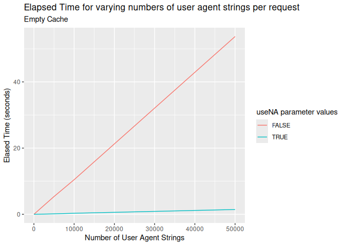
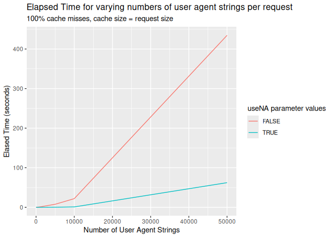
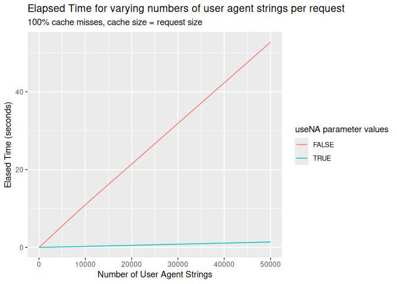

<figure>

<figcaption aria-hidden="true">License</figcaption>
</figure>

# uaparserjs

Parses HTTP user agent strings and returns user agent, device and OS
information. This is a ‘V8’-backed package based on the ‘ua-parser’
project <https://github.com/ua-parser>.

## Functions

The following functions are implemented:

- `ua_parse`: Parse a vector of user agents into a data frame

## Installation

``` r
install.packages("uaparserjs")
```

## Example Usage

``` r
library(uaparserjs)

# current version
packageVersion("uaparserjs")
```

    ## [1] '0.4.0'

``` r
dplyr::glimpse(ua_parse("Mozilla/5.0 (X11; Linux x86_64) AppleWebKit/535.2 (KHTML, like Gecko) Ubuntu/11.10 Chromium/15.0.874.106 Chrome/15.0.874.106 Safari/535.2"))
```

    ## Rows: 1
    ## Columns: 9
    ## $ userAgent     <chr> "Mozilla/5.0 (X11; Linux x86_64) AppleWebKit/535.2 (KHTM…
    ## $ ua.family     <chr> "Chromium"
    ## $ ua.major      <chr> "15"
    ## $ ua.minor      <chr> "0"
    ## $ ua.patch      <chr> "874"
    ## $ os.family     <chr> "Ubuntu"
    ## $ os.major      <chr> "11"
    ## $ os.minor      <chr> "10"
    ## $ device.family <chr> "Other"

``` r
agents <- readLines(system.file("extdat", "agents.txt", package = "uaparserjs"))

dplyr::glimpse(ua_parse(agents))
```

    ## Rows: 1,091
    ## Columns: 13
    ## $ userAgent     <chr> "Mozilla/5.0 (Windows; U; en-US) AppleWebKit/531.9 (KHTM…
    ## $ ua.family     <chr> "AdobeAIR", "Amazon Silk", "Amazon Silk", "Amazon Silk",…
    ## $ ua.major      <chr> "2", "1", "2", "2", "2", "3", "2", "2", "2", "2", "3", "…
    ## $ ua.minor      <chr> "5", "1", "0", "1", "2", "25", "2", "3", "3", "3", "0", …
    ## $ ua.patch      <chr> "1", "0-80", NA, NA, NA, NA, "2", "3", "4", "5", "1", "3…
    ## $ os.family     <chr> "Windows", "Android", "Android", "Android", "Android", "…
    ## $ device.family <chr> "Other", "Kindle", "Kindle Fire HD", "Kindle Fire", "Kin…
    ## $ device.brand  <chr> NA, "Amazon", "Amazon", "Amazon", "Amazon", "Amazon", "H…
    ## $ device.model  <chr> NA, "Kindle", "Kindle Fire HD 7\"", "Kindle Fire", "Kind…
    ## $ os.major      <chr> NA, NA, NA, NA, NA, "4", "2", "2", "2", "2", "3", "4", "…
    ## $ os.minor      <chr> NA, NA, NA, NA, NA, "0", "2", "3", "3", "3", "0", "0", "…
    ## $ os.patch      <chr> NA, NA, NA, NA, NA, "3", "2", "3", "4", "5", "1", "3", "…
    ## $ os.patchMinor <chr> NA, NA, NA, NA, NA, NA, NA, NA, NA, NA, NA, NA, NA, NA, …

## Performance

Time for parsing small numbers of UA strings with useNA defaulting to
FALSE and list cache

``` r
set.seed(100)
#batch_100 <- sample(agents, 100)
assign("cache", list(), envir=uaparserjs:::.pkgenv)
microbenchmark::microbenchmark(
  ua_parse(agents)
)
```

    ## Unit: seconds
    ##              expr      min       lq     mean   median       uq      max neval
    ##  ua_parse(agents) 1.230242 1.274419 1.306185 1.299452 1.332416 1.522362   100

Time for parsing small numbers of UA strings with list cache and
useNA=TRUE

``` r
set.seed(100)
#batch_100 <- sample(agents, 100)
assign("cache", list(), envir=uaparserjs:::.pkgenv)
microbenchmark::microbenchmark(
  ua_parse(agents,useNA=TRUE)
)
```

    ## Unit: milliseconds
    ##                            expr      min      lq     mean   median       uq
    ##  ua_parse(agents, useNA = TRUE) 31.55939 36.4024 44.03564 38.06212 39.90679
    ##       max neval
    ##  582.4312   100

Time for parsing small numbers of UA strings with environment cache and
useNA=TRUE

``` r
set.seed(100)
#batch_100 <- sample(agents, 100)
assign("cache", new.env(), envir=uaparserjs:::.pkgenv)
microbenchmark::microbenchmark(
  ua_parse(agents,useNA=TRUE)
)
```

    ## Unit: milliseconds
    ##                            expr      min       lq     mean   median       uq
    ##  ua_parse(agents, useNA = TRUE) 27.53631 33.13031 40.71838 35.76616 37.97613
    ##       max neval
    ##  535.2129   100

### Effect of useNA

This addresses relative performance with and without the useNA flag.
This test exercises the plumbing that handles unpacking the parameter
list and compilation of the results with effectively no cache
involvement. This test minimises the effect of caching by using the same
UA string over and over. This test does not call the underlying
Javascript parser repeatedly, values are passed to the JavaScript parser
one at a time and parse results are cached for each user agent.

<!-- -->

#### Raw data

``` r
class(results2) = "data.frame"
results2
```

    ##                                                                                     expr
    ## 1                                     uaparserjs::ua_parse(rep(workingUA, i), useNA = f)
    ## 2          uaparserjs::ua_parse(rep(workingUA, i), useNA = f).list(1, 2048688, 50, TRUE)
    ## 3         uaparserjs::ua_parse(rep(workingUA, i), useNA = f).list(1, 3093938, 100, TRUE)
    ## 4        uaparserjs::ua_parse(rep(workingUA, i), useNA = f).list(1, 11911549, 500, TRUE)
    ## 5       uaparserjs::ua_parse(rep(workingUA, i), useNA = f).list(1, 23629774, 1000, TRUE)
    ## 6      uaparserjs::ua_parse(rep(workingUA, i), useNA = f).list(1, 131288542, 5000, TRUE)
    ## 7     uaparserjs::ua_parse(rep(workingUA, i), useNA = f).list(1, 319359199, 10000, TRUE)
    ## 8    uaparserjs::ua_parse(rep(workingUA, i), useNA = f).list(1, 1448103817, 50000, TRUE)
    ## 9        uaparserjs::ua_parse(rep(workingUA, i), useNA = f).list(1, 14191446, 10, FALSE)
    ## 10       uaparserjs::ua_parse(rep(workingUA, i), useNA = f).list(1, 54778869, 50, FALSE)
    ## 11     uaparserjs::ua_parse(rep(workingUA, i), useNA = f).list(1, 111332221, 100, FALSE)
    ## 12     uaparserjs::ua_parse(rep(workingUA, i), useNA = f).list(1, 538215923, 500, FALSE)
    ## 13   uaparserjs::ua_parse(rep(workingUA, i), useNA = f).list(1, 1077447407, 1000, FALSE)
    ## 14   uaparserjs::ua_parse(rep(workingUA, i), useNA = f).list(1, 5369082177, 5000, FALSE)
    ## 15 uaparserjs::ua_parse(rep(workingUA, i), useNA = f).list(1, 10456872749, 10000, FALSE)
    ## 16 uaparserjs::ua_parse(rep(workingUA, i), useNA = f).list(1, 53705485643, 50000, FALSE)
    ##           time UAcount useNA      timesec
    ## 1      2277664      10  TRUE  0.002277664
    ## 2      2048688      50  TRUE  0.002048688
    ## 3      3093938     100  TRUE  0.003093938
    ## 4     11911549     500  TRUE  0.011911549
    ## 5     23629774    1000  TRUE  0.023629774
    ## 6    131288542    5000  TRUE  0.131288542
    ## 7    319359199   10000  TRUE  0.319359199
    ## 8   1448103817   50000  TRUE  1.448103817
    ## 9     14191446      10 FALSE  0.014191446
    ## 10    54778869      50 FALSE  0.054778869
    ## 11   111332221     100 FALSE  0.111332221
    ## 12   538215923     500 FALSE  0.538215923
    ## 13  1077447407    1000 FALSE  1.077447407
    ## 14  5369082177    5000 FALSE  5.369082177
    ## 15 10456872749   10000 FALSE 10.456872749
    ## 16 53705485643   50000 FALSE 53.705485643

### Effect of cache misses with large cache sizes

This examines the worst-case effect of cache misses with large cache
sizes. The cache is populated with a number of unique strings, the
number matching the test case size.  
Every measured call experiences that number of cache misses before
finding its value in the cache, for example with 1000 User Agent strings
passed in 1000 unique cache entries are created before the test and the
test finds the last cache entry.

The test is coded to force use of a list() because list will be removed
in the next release (see test results below).

``` r
results = c()

for(f in naFlags)
{
  for(i in counts)
  {
    unloadNamespace("uaparserjs")
    assign("cache", list(), envir=uaparserjs:::.pkgenv)

    for(j in 1:i)
    {
      # fake the right number of UA strings for this request cycle
      uaparserjs::ua_parse(paste(j, workingUA),useNA = TRUE)
    }
    bmResult = microbenchmark::microbenchmark(uaparserjs::ua_parse(rep(workingUA,i),useNA = f),times = 1)
    bmResult$UAcount = i
    bmResult$useNA = f
    results = c(results, list(bmResult))
  }  
}

results2 = do.call("rbind", results)

results2$timesec = results2$time/1000000000

library(ggplot2) 

ggplot(results2, aes(UAcount)) + 
 aes(x=UAcount, y=timesec, colour=useNA) + 
 geom_line() +
 labs(
    title = "Elapsed Time for varying numbers of user agent strings per request",
    subtitle = "100% cache misses, cache size = request size",
    x = "Number of User Agent Strings",
    y = "Elased Time (seconds)",
    color = "useNA parameter values"
  )
```

<!-- -->

#### Raw Data

``` r
class(results2) = "data.frame"
results2
```

    ##                                                                                      expr
    ## 1                                      uaparserjs::ua_parse(rep(workingUA, i), useNA = f)
    ## 2           uaparserjs::ua_parse(rep(workingUA, i), useNA = f).list(1, 3330069, 50, TRUE)
    ## 3          uaparserjs::ua_parse(rep(workingUA, i), useNA = f).list(1, 4165148, 100, TRUE)
    ## 4         uaparserjs::ua_parse(rep(workingUA, i), useNA = f).list(1, 17082272, 500, TRUE)
    ## 5        uaparserjs::ua_parse(rep(workingUA, i), useNA = f).list(1, 32123521, 1000, TRUE)
    ## 6       uaparserjs::ua_parse(rep(workingUA, i), useNA = f).list(1, 276723239, 5000, TRUE)
    ## 7     uaparserjs::ua_parse(rep(workingUA, i), useNA = f).list(1, 1011251300, 10000, TRUE)
    ## 8    uaparserjs::ua_parse(rep(workingUA, i), useNA = f).list(1, 62306937133, 50000, TRUE)
    ## 9         uaparserjs::ua_parse(rep(workingUA, i), useNA = f).list(1, 12241732, 10, FALSE)
    ## 10        uaparserjs::ua_parse(rep(workingUA, i), useNA = f).list(1, 51719883, 50, FALSE)
    ## 11      uaparserjs::ua_parse(rep(workingUA, i), useNA = f).list(1, 105408103, 100, FALSE)
    ## 12      uaparserjs::ua_parse(rep(workingUA, i), useNA = f).list(1, 520955656, 500, FALSE)
    ## 13    uaparserjs::ua_parse(rep(workingUA, i), useNA = f).list(1, 1115157118, 1000, FALSE)
    ## 14    uaparserjs::ua_parse(rep(workingUA, i), useNA = f).list(1, 7709131441, 5000, FALSE)
    ## 15  uaparserjs::ua_parse(rep(workingUA, i), useNA = f).list(1, 21918423943, 10000, FALSE)
    ## 16 uaparserjs::ua_parse(rep(workingUA, i), useNA = f).list(1, 434529588060, 50000, FALSE)
    ##            time UAcount useNA       timesec
    ## 1       2221922      10  TRUE   0.002221922
    ## 2       3330069      50  TRUE   0.003330069
    ## 3       4165148     100  TRUE   0.004165148
    ## 4      17082272     500  TRUE   0.017082272
    ## 5      32123521    1000  TRUE   0.032123521
    ## 6     276723239    5000  TRUE   0.276723239
    ## 7    1011251300   10000  TRUE   1.011251300
    ## 8   62306937133   50000  TRUE  62.306937133
    ## 9      12241732      10 FALSE   0.012241732
    ## 10     51719883      50 FALSE   0.051719883
    ## 11    105408103     100 FALSE   0.105408103
    ## 12    520955656     500 FALSE   0.520955656
    ## 13   1115157118    1000 FALSE   1.115157118
    ## 14   7709131441    5000 FALSE   7.709131441
    ## 15  21918423943   10000 FALSE  21.918423943
    ## 16 434529588060   50000 FALSE 434.529588060

### Effect of cache misses with large cache sizes using an environment instead of list as cache.

Using an environment, the only native hashmap structure in base R, worst
case performance is significantly better than using a list. How much
this matters depends very much on the distribution of UAs in the input
data, but when dealing with two to four million access log records its
worth recovering every possible second.

``` r
results = c()

library(uaparserjs)

for(f in naFlags)
{
  for(i in counts)
  {
    assign("cache", new.env(), envir=uaparserjs:::.pkgenv)
    for(j in 1:i)
    {
      # fake the right number of UA strings for this request cycle
      uaparserjs::ua_parse(paste(j, workingUA),useNA = TRUE)
    }
    bmResult = microbenchmark::microbenchmark(uaparserjs::ua_parse(rep(workingUA,i),useNA = f),times = 1)
    bmResult$UAcount = i
    bmResult$useNA = f
    results = c(results, list(bmResult))
  }  
}

results3 = do.call("rbind", results)

results3$timesec = results3$time/1000000000

library(ggplot2) 

ggplot(results3, aes(UAcount)) + 
 aes(x=UAcount, y=timesec, colour=useNA) + 
 geom_line() +
 labs(
    title = "Elapsed Time for varying numbers of user agent strings per request",
    subtitle = "100% cache misses, cache size = request size",
    x = "Number of User Agent Strings",
    y = "Elased Time (seconds)",
    color = "useNA parameter values"
  )
```

<!-- -->

#### Raw Data

``` r
class(results3) = "data.frame"
results3
```

    ##                                                                                     expr
    ## 1                                     uaparserjs::ua_parse(rep(workingUA, i), useNA = f)
    ## 2          uaparserjs::ua_parse(rep(workingUA, i), useNA = f).list(1, 3612107, 50, TRUE)
    ## 3         uaparserjs::ua_parse(rep(workingUA, i), useNA = f).list(1, 4212055, 100, TRUE)
    ## 4        uaparserjs::ua_parse(rep(workingUA, i), useNA = f).list(1, 13765687, 500, TRUE)
    ## 5       uaparserjs::ua_parse(rep(workingUA, i), useNA = f).list(1, 25481705, 1000, TRUE)
    ## 6      uaparserjs::ua_parse(rep(workingUA, i), useNA = f).list(1, 128063436, 5000, TRUE)
    ## 7     uaparserjs::ua_parse(rep(workingUA, i), useNA = f).list(1, 258059169, 10000, TRUE)
    ## 8    uaparserjs::ua_parse(rep(workingUA, i), useNA = f).list(1, 1394473442, 50000, TRUE)
    ## 9        uaparserjs::ua_parse(rep(workingUA, i), useNA = f).list(1, 16555736, 10, FALSE)
    ## 10       uaparserjs::ua_parse(rep(workingUA, i), useNA = f).list(1, 53977570, 50, FALSE)
    ## 11     uaparserjs::ua_parse(rep(workingUA, i), useNA = f).list(1, 102167137, 100, FALSE)
    ## 12     uaparserjs::ua_parse(rep(workingUA, i), useNA = f).list(1, 532422069, 500, FALSE)
    ## 13   uaparserjs::ua_parse(rep(workingUA, i), useNA = f).list(1, 1062102735, 1000, FALSE)
    ## 14   uaparserjs::ua_parse(rep(workingUA, i), useNA = f).list(1, 5524649017, 5000, FALSE)
    ## 15 uaparserjs::ua_parse(rep(workingUA, i), useNA = f).list(1, 10968916653, 10000, FALSE)
    ## 16 uaparserjs::ua_parse(rep(workingUA, i), useNA = f).list(1, 52765686701, 50000, FALSE)
    ##           time UAcount useNA      timesec
    ## 1      3829436      10  TRUE  0.003829436
    ## 2      3612107      50  TRUE  0.003612107
    ## 3      4212055     100  TRUE  0.004212055
    ## 4     13765687     500  TRUE  0.013765687
    ## 5     25481705    1000  TRUE  0.025481705
    ## 6    128063436    5000  TRUE  0.128063436
    ## 7    258059169   10000  TRUE  0.258059169
    ## 8   1394473442   50000  TRUE  1.394473442
    ## 9     16555736      10 FALSE  0.016555736
    ## 10    53977570      50 FALSE  0.053977570
    ## 11   102167137     100 FALSE  0.102167137
    ## 12   532422069     500 FALSE  0.532422069
    ## 13  1062102735    1000 FALSE  1.062102735
    ## 14  5524649017    5000 FALSE  5.524649017
    ## 15 10968916653   10000 FALSE 10.968916653
    ## 16 52765686701   50000 FALSE 52.765686701
