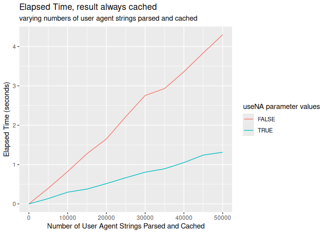
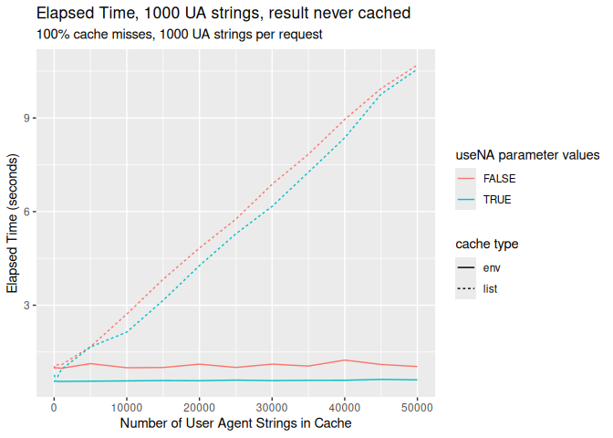

<figure>

<figcaption aria-hidden="true">License</figcaption>
</figure>

# uaparserjs

Parses HTTP user agent strings and returns user agent, device and OS
information.  
This is a ‘V8’-backed package that uses the UA, device and OS
definitions from the ‘ua-parser’ project <https://github.com/ua-parser>.

## Functions

The following functions are implemented:

- `ua_parse`: Parse a vector of user agents into a data frame

## Installation

``` r
#install.packages("uaparserjs")
```

## Example Usage

``` r
library(uaparserjs)

# current version
packageVersion("uaparserjs")
```

    ## [1] '0.4.1'

``` r
dplyr::glimpse(ua_parse("Mozilla/5.0 (X11; Linux x86_64) AppleWebKit/535.2 (KHTML, like Gecko) Ubuntu/11.10 Chromium/15.0.874.106 Chrome/15.0.874.106 Safari/535.2"))
```

    ## Rows: 1
    ## Columns: 9
    ## $ userAgent     <chr> "Mozilla/5.0 (X11; Linux x86_64) AppleWebKit/535.2 (KHTM…
    ## $ ua.family     <chr> "Chromium"
    ## $ ua.major      <chr> "15"
    ## $ ua.minor      <chr> "0"
    ## $ ua.patch      <chr> "874"
    ## $ os.family     <chr> "Ubuntu"
    ## $ os.major      <chr> "11"
    ## $ os.minor      <chr> "10"
    ## $ device.family <chr> "Other"

``` r
agents <- readLines(system.file("extdat", "agents.txt", package = "uaparserjs"))

dplyr::glimpse(ua_parse(agents))
```

    ## Rows: 1,091
    ## Columns: 13
    ## $ userAgent     <chr> "Mozilla/5.0 (Windows; U; en-US) AppleWebKit/531.9 (KHTM…
    ## $ ua.family     <chr> "AdobeAIR", "Amazon Silk", "Amazon Silk", "Amazon Silk",…
    ## $ ua.major      <chr> "2", "1", "2", "2", "2", "3", "2", "2", "2", "2", "3", "…
    ## $ ua.minor      <chr> "5", "1", "0", "1", "2", "25", "2", "3", "3", "3", "0", …
    ## $ ua.patch      <chr> "1", "0-80", NA, NA, NA, NA, "2", "3", "4", "5", "1", "3…
    ## $ os.family     <chr> "Windows", "Android", "Android", "Android", "Android", "…
    ## $ device.family <chr> "Other", "Kindle", "Kindle Fire HD", "Kindle Fire", "Kin…
    ## $ device.brand  <chr> NA, "Amazon", "Amazon", "Amazon", "Amazon", "Amazon", "H…
    ## $ device.model  <chr> NA, "Kindle", "Kindle Fire HD 7\"", "Kindle Fire", "Kind…
    ## $ os.major      <chr> NA, NA, NA, NA, NA, "4", "2", "2", "2", "2", "3", "4", "…
    ## $ os.minor      <chr> NA, NA, NA, NA, NA, "0", "2", "3", "3", "3", "0", "0", "…
    ## $ os.patch      <chr> NA, NA, NA, NA, NA, "3", "2", "3", "4", "5", "1", "3", "…
    ## $ os.patchMinor <chr> NA, NA, NA, NA, NA, NA, NA, NA, NA, NA, NA, NA, NA, NA, …

## Performance

This release uses an env as a cache instead of a list. Retrieval of
values is noticeably faster with an environment than with a list but
storage is slower.  
As is always the case with caching, the ratio of retrieval to storage
determines the how (and whether) the store/retrieve cost trade-offs pay
off.

### Time for parsing small numbers of UA strings with useNA defaulting to FALSE and list cache

``` r
uaparserjs:::cache_reset(list())

microbenchmark::microbenchmark(
  ua_parse(agents)
)
```

    ## Unit: milliseconds
    ##              expr      min       lq     mean   median       uq      max neval
    ##  ua_parse(agents) 294.5307 318.0172 340.5518 334.5562 348.2405 1144.273   100

### Time for parsing small numbers of UA strings with useNA defaulting to FALSE and an env type cache

``` r
uaparserjs:::cache_reset(new.env())

microbenchmark::microbenchmark(
  ua_parse(agents)
)
```

    ## Unit: milliseconds
    ##              expr      min       lq     mean  median       uq      max neval
    ##  ua_parse(agents) 291.8168 317.7188 348.6002 333.535 352.0616 1108.954   100

### Time for parsing small numbers of UA strings with useNA=TRUE and list cache

``` r
uaparserjs:::cache_reset(list())

microbenchmark::microbenchmark(
  ua_parse(agents, useNA=TRUE)
)
```

    ## Unit: milliseconds
    ##                            expr      min       lq     mean   median       uq
    ##  ua_parse(agents, useNA = TRUE) 30.25396 32.86566 40.10931 34.39497 35.67279
    ##       max neval
    ##  572.7531   100

### Time for parsing small numbers of UA strings with environment cache and useNA=TRUE

``` r
uaparserjs:::cache_reset(new.env())

microbenchmark::microbenchmark(
  ua_parse(agents, useNA=TRUE)
)
```

    ## Unit: milliseconds
    ##                            expr      min       lq     mean   median       uq
    ##  ua_parse(agents, useNA = TRUE) 27.25008 30.38409 37.46013 31.97144 34.39136
    ##       max neval
    ##  524.0062   100

### The effect of the useNA plumbing changes and number of UAs

This addresses relative performance with and without the useNA flag by
repeatedly checking copies of the same URL (using the default
environment type cache).  
This exercises unpacking the parameter list and structuring of of the
results (the code is faster with useNA=TRUE than with useNA=FALSE,
probably from rationalising the conversion of results to a data frame).
This test minimises the effect of caching by using the same UA string
over and over. Because of caching, this test does not call the
underlying Javascript parser repeatedly.

``` r
options(scipen=999)
unloadNamespace("usparserjs") # clear cache

workingUA = "Mozilla/5.0 (X11; Linux x86_64) AppleWebKit/535.2 (KHTML, like Gecko) Ubuntu/11.10 Chromium/15.0.874.106 Chrome/15.0.874.106 Safari/535.2"
counts = c(10, 50, 100, 500, 1000, 5000, 10000, 15000, 20000, 25000, 30000, 35000, 40000, 45000, 50000)

naFlags = c(TRUE, FALSE)

results = c()

for(f in naFlags)
{
  for(i in counts)
  {
    bmResult = microbenchmark::microbenchmark(uaparserjs::ua_parse(rep(workingUA, i), useNA = f), times = 1)
    bmResult$UAcount = i
    bmResult$useNA = f
    results = c(results, list(bmResult))
  }  
}

results2 = do.call("rbind", results)

results2$timesec = results2$time/1000000000

library(ggplot2) 

ggplot(results2, aes(UAcount)) + 
 aes(x=UAcount, y=timesec, colour=useNA) + 
 geom_line() +
 labs(
    title = "Elapsed Time, result always cached",
    subtitle = "varying numbers of user agent strings parsed and cached",
    x = "Number of User Agent Strings Parsed and Cached",
    y = "Elapsed Time (seconds)",
    color = "useNA parameter values"
  )
```

<!-- -->

#### Raw data

``` r
class(results2) = "data.frame"
results2
```

    ##                                                                                    expr
    ## 1                                    uaparserjs::ua_parse(rep(workingUA, i), useNA = f)
    ## 2         uaparserjs::ua_parse(rep(workingUA, i), useNA = f).list(1, 2092145, 50, TRUE)
    ## 3        uaparserjs::ua_parse(rep(workingUA, i), useNA = f).list(1, 3033528, 100, TRUE)
    ## 4       uaparserjs::ua_parse(rep(workingUA, i), useNA = f).list(1, 11815560, 500, TRUE)
    ## 5      uaparserjs::ua_parse(rep(workingUA, i), useNA = f).list(1, 26587571, 1000, TRUE)
    ## 6     uaparserjs::ua_parse(rep(workingUA, i), useNA = f).list(1, 136240545, 5000, TRUE)
    ## 7    uaparserjs::ua_parse(rep(workingUA, i), useNA = f).list(1, 298674586, 10000, TRUE)
    ## 8    uaparserjs::ua_parse(rep(workingUA, i), useNA = f).list(1, 377964783, 15000, TRUE)
    ## 9    uaparserjs::ua_parse(rep(workingUA, i), useNA = f).list(1, 516710348, 20000, TRUE)
    ## 10   uaparserjs::ua_parse(rep(workingUA, i), useNA = f).list(1, 665461045, 25000, TRUE)
    ## 11   uaparserjs::ua_parse(rep(workingUA, i), useNA = f).list(1, 806556960, 30000, TRUE)
    ## 12   uaparserjs::ua_parse(rep(workingUA, i), useNA = f).list(1, 893212928, 35000, TRUE)
    ## 13  uaparserjs::ua_parse(rep(workingUA, i), useNA = f).list(1, 1051374793, 40000, TRUE)
    ## 14  uaparserjs::ua_parse(rep(workingUA, i), useNA = f).list(1, 1241690362, 45000, TRUE)
    ## 15  uaparserjs::ua_parse(rep(workingUA, i), useNA = f).list(1, 1312724278, 50000, TRUE)
    ## 16       uaparserjs::ua_parse(rep(workingUA, i), useNA = f).list(1, 2536549, 10, FALSE)
    ## 17       uaparserjs::ua_parse(rep(workingUA, i), useNA = f).list(1, 3917369, 50, FALSE)
    ## 18      uaparserjs::ua_parse(rep(workingUA, i), useNA = f).list(1, 7488830, 100, FALSE)
    ## 19     uaparserjs::ua_parse(rep(workingUA, i), useNA = f).list(1, 37849645, 500, FALSE)
    ## 20    uaparserjs::ua_parse(rep(workingUA, i), useNA = f).list(1, 81026459, 1000, FALSE)
    ## 21   uaparserjs::ua_parse(rep(workingUA, i), useNA = f).list(1, 399110346, 5000, FALSE)
    ## 22  uaparserjs::ua_parse(rep(workingUA, i), useNA = f).list(1, 823132758, 10000, FALSE)
    ## 23 uaparserjs::ua_parse(rep(workingUA, i), useNA = f).list(1, 1278412022, 15000, FALSE)
    ## 24 uaparserjs::ua_parse(rep(workingUA, i), useNA = f).list(1, 1651392396, 20000, FALSE)
    ## 25 uaparserjs::ua_parse(rep(workingUA, i), useNA = f).list(1, 2218048992, 25000, FALSE)
    ## 26 uaparserjs::ua_parse(rep(workingUA, i), useNA = f).list(1, 2756208048, 30000, FALSE)
    ## 27 uaparserjs::ua_parse(rep(workingUA, i), useNA = f).list(1, 2932352811, 35000, FALSE)
    ## 28 uaparserjs::ua_parse(rep(workingUA, i), useNA = f).list(1, 3359748246, 40000, FALSE)
    ## 29 uaparserjs::ua_parse(rep(workingUA, i), useNA = f).list(1, 3838969074, 45000, FALSE)
    ## 30 uaparserjs::ua_parse(rep(workingUA, i), useNA = f).list(1, 4300164261, 50000, FALSE)
    ##          time UAcount useNA     timesec
    ## 1     2163836      10  TRUE 0.002163836
    ## 2     2092145      50  TRUE 0.002092145
    ## 3     3033528     100  TRUE 0.003033528
    ## 4    11815560     500  TRUE 0.011815560
    ## 5    26587571    1000  TRUE 0.026587571
    ## 6   136240545    5000  TRUE 0.136240545
    ## 7   298674586   10000  TRUE 0.298674586
    ## 8   377964783   15000  TRUE 0.377964783
    ## 9   516710348   20000  TRUE 0.516710348
    ## 10  665461045   25000  TRUE 0.665461045
    ## 11  806556960   30000  TRUE 0.806556960
    ## 12  893212928   35000  TRUE 0.893212928
    ## 13 1051374793   40000  TRUE 1.051374793
    ## 14 1241690362   45000  TRUE 1.241690362
    ## 15 1312724278   50000  TRUE 1.312724278
    ## 16    2536549      10 FALSE 0.002536549
    ## 17    3917369      50 FALSE 0.003917369
    ## 18    7488830     100 FALSE 0.007488830
    ## 19   37849645     500 FALSE 0.037849645
    ## 20   81026459    1000 FALSE 0.081026459
    ## 21  399110346    5000 FALSE 0.399110346
    ## 22  823132758   10000 FALSE 0.823132758
    ## 23 1278412022   15000 FALSE 1.278412022
    ## 24 1651392396   20000 FALSE 1.651392396
    ## 25 2218048992   25000 FALSE 2.218048992
    ## 26 2756208048   30000 FALSE 2.756208048
    ## 27 2932352811   35000 FALSE 2.932352811
    ## 28 3359748246   40000 FALSE 3.359748246
    ## 29 3838969074   45000 FALSE 3.838969074
    ## 30 4300164261   50000 FALSE 4.300164261

### Effect of cache misses with large cache sizes

This examines the worst-case effect of cache misses with various cache
sizes. The cache is populated with a number of unique strings, the
number matching the test case size.  
In the list cache case, every measured call experiences that number of
cache misses before finding its value in the cache, for example with
1000 User Agent strings passed in 1000 unique cache entries are created
before the test and the test finds the last-created cache entry.

``` r
results = c()

for(f in naFlags)
{
  for(i in counts)
  {
    uaparserjs:::cache_reset(list())

    for(j in 1:i)
    {
      # fake the right number of UA strings for this request cycle
      uaparserjs::ua_parse(paste(j, workingUA),useNA = TRUE)
    }
    bmResult = microbenchmark::microbenchmark(uaparserjs::ua_parse(paste(rep(workingUA, 1000), seq(1, 1000)), useNA = f), times = 1)
    bmResult$UAcount = i
    bmResult$useNA = f
    bmResult$cacheType = "list"
    results = c(results, list(bmResult))
  }  
}

for(f in naFlags)
{
  for(i in counts)
  {
    uaparserjs:::cache_reset(new.env())

    for(j in 1:i)
    {
      # fake the right number of UA strings for this request cycle
      uaparserjs::ua_parse(paste(j, workingUA), useNA = TRUE)
    }
    bmResult = microbenchmark::microbenchmark(uaparserjs::ua_parse(paste(rep(workingUA, 1000), seq(1, 1000)), useNA = f), times = 1)
    bmResult$UAcount = i
    bmResult$useNA = f
    bmResult$cacheType = "env"
    results = c(results, list(bmResult))
  }  
}

results2 = do.call("rbind", results)

results2$timesec = results2$time/1000000000

library(ggplot2) 

ggplot(results2, aes(UAcount)) + 
 aes(x=UAcount, y=timesec, colour=useNA, linetype=cacheType) + 
 geom_line() +
 labs(
    title = "Elapsed Time, 1000 UA strings, result never cached",
    subtitle = "100% cache misses, 1000 UA strings per request",
    x = "Number of User Agent Strings in Cache",
    y = "Elapsed Time (seconds)",
    color = "useNA parameter values",
    linetype = "cache type"
  )
```

<!-- -->

#### Raw Data

``` r
class(results2) = "data.frame"
results2
```

    ##                                                                                                                          expr
    ## 1                                             uaparserjs::ua_parse(paste(rep(workingUA, 1000), seq(1, 1000)),      useNA = f)
    ## 2        uaparserjs::ua_parse(paste(rep(workingUA, 1000), seq(1, 1000)),      useNA = f).list(1, 743330093, 50, TRUE, "list")
    ## 3       uaparserjs::ua_parse(paste(rep(workingUA, 1000), seq(1, 1000)),      useNA = f).list(1, 687023475, 100, TRUE, "list")
    ## 4       uaparserjs::ua_parse(paste(rep(workingUA, 1000), seq(1, 1000)),      useNA = f).list(1, 712953112, 500, TRUE, "list")
    ## 5      uaparserjs::ua_parse(paste(rep(workingUA, 1000), seq(1, 1000)),      useNA = f).list(1, 940112986, 1000, TRUE, "list")
    ## 6     uaparserjs::ua_parse(paste(rep(workingUA, 1000), seq(1, 1000)),      useNA = f).list(1, 1663434339, 5000, TRUE, "list")
    ## 7    uaparserjs::ua_parse(paste(rep(workingUA, 1000), seq(1, 1000)),      useNA = f).list(1, 2138156294, 10000, TRUE, "list")
    ## 8    uaparserjs::ua_parse(paste(rep(workingUA, 1000), seq(1, 1000)),      useNA = f).list(1, 3156099939, 15000, TRUE, "list")
    ## 9    uaparserjs::ua_parse(paste(rep(workingUA, 1000), seq(1, 1000)),      useNA = f).list(1, 4268484835, 20000, TRUE, "list")
    ## 10   uaparserjs::ua_parse(paste(rep(workingUA, 1000), seq(1, 1000)),      useNA = f).list(1, 5285002119, 25000, TRUE, "list")
    ## 11   uaparserjs::ua_parse(paste(rep(workingUA, 1000), seq(1, 1000)),      useNA = f).list(1, 6167056692, 30000, TRUE, "list")
    ## 12   uaparserjs::ua_parse(paste(rep(workingUA, 1000), seq(1, 1000)),      useNA = f).list(1, 7261052530, 35000, TRUE, "list")
    ## 13   uaparserjs::ua_parse(paste(rep(workingUA, 1000), seq(1, 1000)),      useNA = f).list(1, 8366200971, 40000, TRUE, "list")
    ## 14   uaparserjs::ua_parse(paste(rep(workingUA, 1000), seq(1, 1000)),      useNA = f).list(1, 9765528485, 45000, TRUE, "list")
    ## 15  uaparserjs::ua_parse(paste(rep(workingUA, 1000), seq(1, 1000)),      useNA = f).list(1, 10562146640, 50000, TRUE, "list")
    ## 16     uaparserjs::ua_parse(paste(rep(workingUA, 1000), seq(1, 1000)),      useNA = f).list(1, 1050952012, 10, FALSE, "list")
    ## 17     uaparserjs::ua_parse(paste(rep(workingUA, 1000), seq(1, 1000)),      useNA = f).list(1, 1000691818, 50, FALSE, "list")
    ## 18    uaparserjs::ua_parse(paste(rep(workingUA, 1000), seq(1, 1000)),      useNA = f).list(1, 1056623206, 100, FALSE, "list")
    ## 19    uaparserjs::ua_parse(paste(rep(workingUA, 1000), seq(1, 1000)),      useNA = f).list(1, 1096723962, 500, FALSE, "list")
    ## 20   uaparserjs::ua_parse(paste(rep(workingUA, 1000), seq(1, 1000)),      useNA = f).list(1, 1087142369, 1000, FALSE, "list")
    ## 21   uaparserjs::ua_parse(paste(rep(workingUA, 1000), seq(1, 1000)),      useNA = f).list(1, 1669946347, 5000, FALSE, "list")
    ## 22  uaparserjs::ua_parse(paste(rep(workingUA, 1000), seq(1, 1000)),      useNA = f).list(1, 2716496664, 10000, FALSE, "list")
    ## 23  uaparserjs::ua_parse(paste(rep(workingUA, 1000), seq(1, 1000)),      useNA = f).list(1, 3830489290, 15000, FALSE, "list")
    ## 24  uaparserjs::ua_parse(paste(rep(workingUA, 1000), seq(1, 1000)),      useNA = f).list(1, 4834051900, 20000, FALSE, "list")
    ## 25  uaparserjs::ua_parse(paste(rep(workingUA, 1000), seq(1, 1000)),      useNA = f).list(1, 5755483595, 25000, FALSE, "list")
    ## 26  uaparserjs::ua_parse(paste(rep(workingUA, 1000), seq(1, 1000)),      useNA = f).list(1, 6875118765, 30000, FALSE, "list")
    ## 27  uaparserjs::ua_parse(paste(rep(workingUA, 1000), seq(1, 1000)),      useNA = f).list(1, 7837714929, 35000, FALSE, "list")
    ## 28  uaparserjs::ua_parse(paste(rep(workingUA, 1000), seq(1, 1000)),      useNA = f).list(1, 8954524515, 40000, FALSE, "list")
    ## 29  uaparserjs::ua_parse(paste(rep(workingUA, 1000), seq(1, 1000)),      useNA = f).list(1, 9943655351, 45000, FALSE, "list")
    ## 30 uaparserjs::ua_parse(paste(rep(workingUA, 1000), seq(1, 1000)),      useNA = f).list(1, 10698030766, 50000, FALSE, "list")
    ## 31        uaparserjs::ua_parse(paste(rep(workingUA, 1000), seq(1, 1000)),      useNA = f).list(1, 577996189, 10, TRUE, "env")
    ## 32        uaparserjs::ua_parse(paste(rep(workingUA, 1000), seq(1, 1000)),      useNA = f).list(1, 553920012, 50, TRUE, "env")
    ## 33       uaparserjs::ua_parse(paste(rep(workingUA, 1000), seq(1, 1000)),      useNA = f).list(1, 577584400, 100, TRUE, "env")
    ## 34       uaparserjs::ua_parse(paste(rep(workingUA, 1000), seq(1, 1000)),      useNA = f).list(1, 557248263, 500, TRUE, "env")
    ## 35      uaparserjs::ua_parse(paste(rep(workingUA, 1000), seq(1, 1000)),      useNA = f).list(1, 558087857, 1000, TRUE, "env")
    ## 36      uaparserjs::ua_parse(paste(rep(workingUA, 1000), seq(1, 1000)),      useNA = f).list(1, 565963340, 5000, TRUE, "env")
    ## 37     uaparserjs::ua_parse(paste(rep(workingUA, 1000), seq(1, 1000)),      useNA = f).list(1, 574153458, 10000, TRUE, "env")
    ## 38     uaparserjs::ua_parse(paste(rep(workingUA, 1000), seq(1, 1000)),      useNA = f).list(1, 585513042, 15000, TRUE, "env")
    ## 39     uaparserjs::ua_parse(paste(rep(workingUA, 1000), seq(1, 1000)),      useNA = f).list(1, 581104190, 20000, TRUE, "env")
    ## 40     uaparserjs::ua_parse(paste(rep(workingUA, 1000), seq(1, 1000)),      useNA = f).list(1, 600090411, 25000, TRUE, "env")
    ## 41     uaparserjs::ua_parse(paste(rep(workingUA, 1000), seq(1, 1000)),      useNA = f).list(1, 583665668, 30000, TRUE, "env")
    ## 42     uaparserjs::ua_parse(paste(rep(workingUA, 1000), seq(1, 1000)),      useNA = f).list(1, 593303365, 35000, TRUE, "env")
    ## 43     uaparserjs::ua_parse(paste(rep(workingUA, 1000), seq(1, 1000)),      useNA = f).list(1, 594791427, 40000, TRUE, "env")
    ## 44     uaparserjs::ua_parse(paste(rep(workingUA, 1000), seq(1, 1000)),      useNA = f).list(1, 623277780, 45000, TRUE, "env")
    ## 45     uaparserjs::ua_parse(paste(rep(workingUA, 1000), seq(1, 1000)),      useNA = f).list(1, 607557833, 50000, TRUE, "env")
    ## 46      uaparserjs::ua_parse(paste(rep(workingUA, 1000), seq(1, 1000)),      useNA = f).list(1, 1015877591, 10, FALSE, "env")
    ## 47       uaparserjs::ua_parse(paste(rep(workingUA, 1000), seq(1, 1000)),      useNA = f).list(1, 981468429, 50, FALSE, "env")
    ## 48      uaparserjs::ua_parse(paste(rep(workingUA, 1000), seq(1, 1000)),      useNA = f).list(1, 994682917, 100, FALSE, "env")
    ## 49      uaparserjs::ua_parse(paste(rep(workingUA, 1000), seq(1, 1000)),      useNA = f).list(1, 991182569, 500, FALSE, "env")
    ## 50     uaparserjs::ua_parse(paste(rep(workingUA, 1000), seq(1, 1000)),      useNA = f).list(1, 979488311, 1000, FALSE, "env")
    ## 51    uaparserjs::ua_parse(paste(rep(workingUA, 1000), seq(1, 1000)),      useNA = f).list(1, 1127760104, 5000, FALSE, "env")
    ## 52    uaparserjs::ua_parse(paste(rep(workingUA, 1000), seq(1, 1000)),      useNA = f).list(1, 996012819, 10000, FALSE, "env")
    ## 53   uaparserjs::ua_parse(paste(rep(workingUA, 1000), seq(1, 1000)),      useNA = f).list(1, 1003847312, 15000, FALSE, "env")
    ## 54   uaparserjs::ua_parse(paste(rep(workingUA, 1000), seq(1, 1000)),      useNA = f).list(1, 1110177655, 20000, FALSE, "env")
    ## 55   uaparserjs::ua_parse(paste(rep(workingUA, 1000), seq(1, 1000)),      useNA = f).list(1, 1005557354, 25000, FALSE, "env")
    ## 56   uaparserjs::ua_parse(paste(rep(workingUA, 1000), seq(1, 1000)),      useNA = f).list(1, 1111310383, 30000, FALSE, "env")
    ## 57   uaparserjs::ua_parse(paste(rep(workingUA, 1000), seq(1, 1000)),      useNA = f).list(1, 1049311833, 35000, FALSE, "env")
    ## 58   uaparserjs::ua_parse(paste(rep(workingUA, 1000), seq(1, 1000)),      useNA = f).list(1, 1241422736, 40000, FALSE, "env")
    ## 59   uaparserjs::ua_parse(paste(rep(workingUA, 1000), seq(1, 1000)),      useNA = f).list(1, 1101028473, 45000, FALSE, "env")
    ## 60   uaparserjs::ua_parse(paste(rep(workingUA, 1000), seq(1, 1000)),      useNA = f).list(1, 1034865971, 50000, FALSE, "env")
    ##           time UAcount useNA cacheType    timesec
    ## 1    770559222      10  TRUE      list  0.7705592
    ## 2    743330093      50  TRUE      list  0.7433301
    ## 3    687023475     100  TRUE      list  0.6870235
    ## 4    712953112     500  TRUE      list  0.7129531
    ## 5    940112986    1000  TRUE      list  0.9401130
    ## 6   1663434339    5000  TRUE      list  1.6634343
    ## 7   2138156294   10000  TRUE      list  2.1381563
    ## 8   3156099939   15000  TRUE      list  3.1560999
    ## 9   4268484835   20000  TRUE      list  4.2684848
    ## 10  5285002119   25000  TRUE      list  5.2850021
    ## 11  6167056692   30000  TRUE      list  6.1670567
    ## 12  7261052530   35000  TRUE      list  7.2610525
    ## 13  8366200971   40000  TRUE      list  8.3662010
    ## 14  9765528485   45000  TRUE      list  9.7655285
    ## 15 10562146640   50000  TRUE      list 10.5621466
    ## 16  1050952012      10 FALSE      list  1.0509520
    ## 17  1000691818      50 FALSE      list  1.0006918
    ## 18  1056623206     100 FALSE      list  1.0566232
    ## 19  1096723962     500 FALSE      list  1.0967240
    ## 20  1087142369    1000 FALSE      list  1.0871424
    ## 21  1669946347    5000 FALSE      list  1.6699463
    ## 22  2716496664   10000 FALSE      list  2.7164967
    ## 23  3830489290   15000 FALSE      list  3.8304893
    ## 24  4834051900   20000 FALSE      list  4.8340519
    ## 25  5755483595   25000 FALSE      list  5.7554836
    ## 26  6875118765   30000 FALSE      list  6.8751188
    ## 27  7837714929   35000 FALSE      list  7.8377149
    ## 28  8954524515   40000 FALSE      list  8.9545245
    ## 29  9943655351   45000 FALSE      list  9.9436554
    ## 30 10698030766   50000 FALSE      list 10.6980308
    ## 31   577996189      10  TRUE       env  0.5779962
    ## 32   553920012      50  TRUE       env  0.5539200
    ## 33   577584400     100  TRUE       env  0.5775844
    ## 34   557248263     500  TRUE       env  0.5572483
    ## 35   558087857    1000  TRUE       env  0.5580879
    ## 36   565963340    5000  TRUE       env  0.5659633
    ## 37   574153458   10000  TRUE       env  0.5741535
    ## 38   585513042   15000  TRUE       env  0.5855130
    ## 39   581104190   20000  TRUE       env  0.5811042
    ## 40   600090411   25000  TRUE       env  0.6000904
    ## 41   583665668   30000  TRUE       env  0.5836657
    ## 42   593303365   35000  TRUE       env  0.5933034
    ## 43   594791427   40000  TRUE       env  0.5947914
    ## 44   623277780   45000  TRUE       env  0.6232778
    ## 45   607557833   50000  TRUE       env  0.6075578
    ## 46  1015877591      10 FALSE       env  1.0158776
    ## 47   981468429      50 FALSE       env  0.9814684
    ## 48   994682917     100 FALSE       env  0.9946829
    ## 49   991182569     500 FALSE       env  0.9911826
    ## 50   979488311    1000 FALSE       env  0.9794883
    ## 51  1127760104    5000 FALSE       env  1.1277601
    ## 52   996012819   10000 FALSE       env  0.9960128
    ## 53  1003847312   15000 FALSE       env  1.0038473
    ## 54  1110177655   20000 FALSE       env  1.1101777
    ## 55  1005557354   25000 FALSE       env  1.0055574
    ## 56  1111310383   30000 FALSE       env  1.1113104
    ## 57  1049311833   35000 FALSE       env  1.0493118
    ## 58  1241422736   40000 FALSE       env  1.2414227
    ## 59  1101028473   45000 FALSE       env  1.1010285
    ## 60  1034865971   50000 FALSE       env  1.0348660
